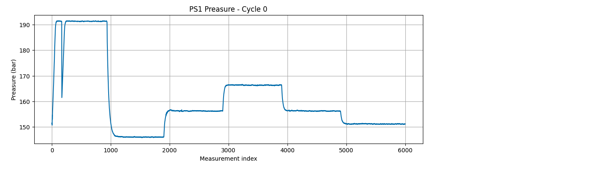

# Data Exploration

This folder contains Jupyter notebooks used to explore and understand the industrial sensor dataset before data processing and visualization.

## 01 — Data Exploration

### Objectives

- Load and inspect raw industrial sensor data using Python and pandas.
- Understand the structure and dimensions of the dataset.
- Check for missing values and inspect data types.
- Calculate descriptive statistics.
- Visualize sensor measurements over time.
- Identify initial observations that can guide further analysis.

### Dataset

This project uses the public [Condition Monitoring of Hydraulic Systems](https://archive.ics.uci.edu/dataset/447/condition+monitoring+of+hydraulic+systems) dataset from the UCI Machine Learning Repository.

The dataset contains measurements collected from a hydraulic test rig under different component conditions.

## Initial Analysis: PS1 Pressure Sensor

The PS1 sensor measures hydraulic pressure in bar at a sampling frequency of **100 Hz**, meaning 100 measurements are recorded per second.

Each measurement cycle lasts **60 seconds** and contains **6,000 measurements**.

In the raw data:

- Each row represents one measurement cycle.
- Each column represents a measurement at a different time point within that cycle.

### Dataset Overview

The initial inspection of the PS1 sensor produced the following results:

| Property | Result |
|---|---:|
| Number of cycles | 2,205 |
| Measurements per cycle | 6,000 |
| Sampling frequency | 100 Hz |
| Cycle duration | 60 seconds |
| Missing values | 0 |
| Data types | `float64` |

### Pressure Over Time — First Cycle

The following plot shows how hydraulic pressure changes over time during the first measurement cycle.

*Figure 1. Hydraulic pressure measured by PS1 during the first cycle.*

### Initial Findings

- The PS1 dataset contains 2,205 measurement cycles.
- Each cycle contains 6,000 pressure measurements.
- All columns contain numeric data (`float64`).
- No missing values were found during the initial inspection.

